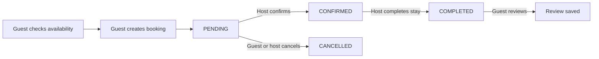
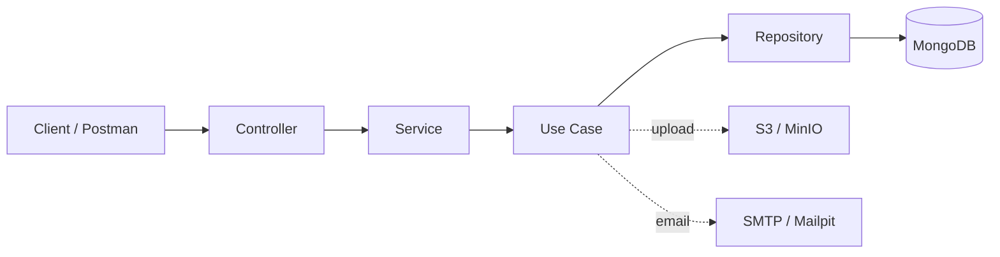

<div align="center">

# 🏡 Airbnb Clone API

### A modular REST API for short-term rentals, bookings, and guest reviews


**A feature-based backend for managing rental listings, availability, reservations, pricing, and reviews.**

[Features](#-features) · [Getting Started](#-getting-started) · [API Reference](#-api-reference) · [Postman](#-postman-testing) · [Architecture](#-architecture)

</div>

---

## 📖 Overview

Airbnb Clone API is a NestJS and TypeScript backend for a rental-booking platform. It provides endpoints for guests, hosts, and system administrators, backed by MongoDB and Mongoose.

The application includes account registration and verification, listing management, photo uploads, booking lifecycle operations, and guest reviews. It also provides reference data management for countries, cities, currencies, and unit categories.

The API is organized into feature modules. Each feature keeps its controllers, DTOs, services, use cases, repositories, schemas, and Swagger documentation together where applicable.

## ✨ Features

- 🔐 **Authentication:** User and system-admin login, JWT access tokens, refresh tokens, and a protected current-account endpoint.
- ✉️ **Email verification:** Six-digit OTP delivery and verification before user registration.
- 🔑 **Password recovery:** Send and verify a reset code, then set a new password.
- 👥 **Role-aware access:** Separate `user` and `admin` flows enforced by authentication and role guards.
- 🏠 **Rental units:** Create, list, filter, update, activate, deactivate, and delete units.
- 🖼️ **Photo management:** Upload, replace, and remove unit photos using S3-compatible object storage.
- 📅 **Bookings:** Check availability, calculate the booking amount and VAT, create reservations, and manage booking status.
- ⭐ **Reviews:** Review completed bookings and browse reviews for a unit.
- 🌍 **Reference data:** Manage countries, cities, currencies, and unit categories.
- ⚙️ **App settings:** Configure the VAT rate and minimum rental price.
- 📧 **Mail testing:** Send a test email through the configured email adapter.
- 📚 **Interactive documentation:** Explore and execute API operations with Swagger UI.
- 🧪 **Ready-to-import Postman collection:** Try API calls with sample JSON, form-data uploads, saved tokens, and captured resource IDs.

## 🧰 Technology Stack

| Technology | Purpose |
| --- | --- |
| [NestJS](https://nestjs.com/) | Modular server-side application framework |
| TypeScript | Application language |
| MongoDB | Document database |
| Mongoose | MongoDB schemas, models, and queries |
| `class-validator` / `class-transformer` | Request validation and transformation |
| JWT / Passport guards | Authentication and access control |
| `@nestjs/swagger` | OpenAPI generation and Swagger UI |
| AWS SDK for JavaScript | S3-compatible file storage |
| MinIO | Local S3-compatible storage for development |
| Nodemailer | Email transport |
| Mailpit | Local SMTP inbox for development and testing |

## ✅ Prerequisites

- Node.js 20 or newer and npm.
- MongoDB running locally or a reachable MongoDB deployment.
- Docker Desktop if you want to run MinIO and Mailpit locally.
- An S3-compatible storage service and SMTP server for file and email features. MinIO and Mailpit can provide these dependencies during local development.

## 🚀 Getting Started

### 1. Install dependencies

```bash
npm ci
```

### 2. Configure environment variables

Create a `.env` file in the project root. The following configuration is suitable as a local starting point; change values to match your local services:

```dotenv
NODE_ENV=development
PORT=3000

# MongoDB
MONGODB_URI=mongodb://localhost:27017/airbnb_clone

# JWT
JWT_SECRET=replace_with_a_long_random_secret
ACCESS_TOKEN_EXPIRES_IN=15m
REFRESH_TOKEN_EXPIRES_IN=7d

# Initial system-admin account
SYSTEM_ADMIN_NAME=System Admin
SYSTEM_ADMIN_EMAIL=admin@example.com
SYSTEM_ADMIN_PASSWORD=replace_with_a_local_password

# S3-compatible storage / local MinIO
AWS_S3_REGION=us-east-1
AWS_S3_ACCESS_KEY_ID=minioadmin
AWS_S3_SECRET_ACCESS_KEY=minioadmin123
AWS_S3_BUCKET_NAME=airbnb-api-clone
MINIO_S3_ENDPOINT=http://localhost:9000

# Local Mailpit SMTP
SMTP_HOST=localhost
SMTP_PORT=1025
SMTP_SECURE=false
SMTP_AUTH_EMAIL=
SMTP_AUTH_PASS=
```

Configuration values are validated at startup. In particular, MongoDB, JWT, system-admin, S3, and SMTP settings are required by the current environment schema. Keep real credentials out of source control; `.env` is ignored by Git.

### 3. Start local infrastructure

```bash
npm run docker:up
```

This starts the MinIO and Mailpit containers defined in `docker-compose.yml`.

| Service | Local address | Notes |
| --- | --- | --- |
| MinIO S3 API | `http://localhost:9000` | S3 endpoint used by the API |
| MinIO Console | `http://localhost:9001` | Manage local buckets and objects |
| Mailpit web inbox | `http://localhost:8025` | Read OTPs and inspect sent email |
| Mailpit SMTP | `localhost:1025` | SMTP host and port for local email |

Create the bucket configured in `AWS_S3_BUCKET_NAME` in the MinIO Console before uploading files, if it does not already exist. The local MinIO credentials are defined in `docker-compose.yml`; use those development-only values when signing in.

> MongoDB is not included in `docker-compose.yml`. Start MongoDB separately or point `MONGODB_URI` to a database you can access.

### 4. Run the API

```bash
# Development mode with file watching
npm run start:dev
```

The app listens on the configured `PORT` (3000 by default). On startup, it creates the initial system-admin account from the environment variables if an account with that email does not already exist.

### 5. Open Swagger

```text
http://localhost:3000/api
```

Swagger UI lists the available endpoints and their DTOs. Use **Authorize** to provide a bearer access token before trying protected endpoints.

## 🔐 Authentication and Roles

The login endpoint accepts one of the following role values:

| Value | Account type | Typical capabilities |
| --- | --- | --- |
| `user` | Registered guest or host | Manage owned units and participate in bookings |
| `admin` | System administrator | Manage users, reference data, and app settings |

After login, use the returned access token in the `Authorization` header:

```http
Authorization: Bearer <accessToken>
```

Registration requires a verified email OTP. To test registration locally:

1. Call `POST /otp/send` with an email address.
2. Open the Mailpit inbox at `http://localhost:8025` and copy the six-digit code.
3. Call `POST /otp/verify` with the same email and code.
4. Call `POST /auth/register` with the verified email and account details.
5. Call `POST /auth/login` with `role: "user"` to receive tokens.

## 🧭 API Reference

All API routes are served from the root path; there is no `/api` route prefix. `/api` is the Swagger UI path.

### Authentication and identity

| Method | Endpoint | Access | Description |
| --- | --- | --- | --- |
| `POST` | `/auth/register` | Public; verified email required | Register a user and issue tokens |
| `POST` | `/auth/login` | Public | Log in as a user or system admin |
| `POST` | `/auth/refresh-token` | Public; refresh token required | Issue a new access/refresh token pair |
| `GET` | `/auth/me` | Authenticated | Return the current principal |
| `POST` | `/otp/send` | Public | Send an email verification code |
| `POST` | `/otp/verify` | Public | Verify an email verification code |
| `POST` | `/forget-password/send` | Public | Send a password-reset code |
| `POST` | `/forget-password/verify` | Public | Verify the password-reset code |
| `POST` | `/forget-password/reset` | Public | Set a new password after verification |

### Accounts and app settings

| Method | Endpoint | Access | Description |
| --- | --- | --- | --- |
| `POST` | `/users` | Admin | Create a user directly |
| `GET` | `/app-settings` | Public | Read VAT and minimum-price settings |
| `PATCH` | `/app-settings` | Admin | Create or update app settings |
| `POST` | `/mail/test` | Authenticated | Send a test email |

### Reference data

These resources support list, get-by-ID, create, update, and soft-delete operations. List and get operations are public; create, update, and delete operations require the system-admin role.

| Resource | Collection endpoint | List filters |
| --- | --- | --- |
| 🌍 Countries | `/countries` | `page`, `limit`, `ignoreLimit`, `name`, `countryCode` |
| 🏙️ Cities | `/cities` | `page`, `limit`, `ignoreLimit`, `name`, `country` |
| 💱 Currencies | `/currencies` | `page`, `limit`, `ignoreLimit`, `name`, `currencyCode` |
| 🏷️ Unit categories | `/unit-categories` | `page`, `limit`, `ignoreLimit`, `name` |

For each resource, the individual operations use:

```text
GET    /<resource>
GET    /<resource>/:id
POST   /<resource>             # Admin
PATCH  /<resource>/:id         # Admin
DELETE /<resource>/:id         # Admin; soft delete, returns 204
```

### Rental units

| Method | Endpoint | Access | Description |
| --- | --- | --- | --- |
| `GET` | `/units` | Public | List active units with filters and pagination |
| `GET` | `/units/me` | User | List units owned by the current user |
| `GET` | `/units/:id` | Public | Get a unit by ID |
| `POST` | `/units` | User | Create a unit and upload photos |
| `PATCH` | `/units/:id` | Owner | Update unit details |
| `PATCH` | `/units/:id/activate` | Owner | Activate a unit |
| `PATCH` | `/units/:id/deactivate` | Owner | Deactivate a unit |
| `PATCH` | `/units/:id/photos` | Owner | Add uploaded photos to a unit |
| `DELETE` | `/units/:id/photos` | Owner | Delete selected photo URLs |
| `DELETE` | `/units/:id` | Owner | Soft-delete a unit; returns 204 |

The list endpoint supports `page`, `limit`, `ignoreLimit`, `title`, `country`, `city`, `unitCategory`, `minCostPerDay`, `maxCostPerDay`, `availability`, and `isActive` filters.

Unit creation and photo updates use `multipart/form-data`. The upload interceptor accepts up to five files per request. Each file can be at most 2 MB; the current validation allows JPEG, PNG, and PDF file signatures.

### Bookings

| Method | Endpoint | Access | Description |
| --- | --- | --- | --- |
| `GET` | `/bookings/check-availability` | Public | Check availability and calculate cost |
| `POST` | `/bookings` | User | Create a booking as guest |
| `GET` | `/bookings` | Admin | List all bookings |
| `GET` | `/bookings/me` | User | List bookings as guest or host |
| `GET` | `/bookings/:bookingId` | Guest, host, or admin | Get booking details |
| `PATCH` | `/bookings/:id` | Guest | Update a pending booking |
| `PATCH` | `/bookings/:id/cancel` | Guest | Cancel a booking |
| `PATCH` | `/bookings/:id/status` | Host | Confirm, cancel, or complete a booking |
| `PATCH` | `/bookings/:id/review` | Guest | Add a review after completion |

Booking list filters include `page`, `limit`, `ignoreLimit`, `status`, `unit`, `checkIn`, and `checkOut`. The current user's list also accepts `userType=guest` or `userType=host`.

The booking amount is calculated from the unit's daily price, stay duration, and the configured VAT settings. A guest cannot book their own unit. The host can confirm a pending booking, cancel an eligible booking, or mark a confirmed booking completed. A guest review is allowed after completion.

### Unit reviews

| Method | Endpoint | Access | Description |
| --- | --- | --- | --- |
| `GET` | `/units/:unitId/reviews` | Public | List reviews for a unit, newest first |

This endpoint supports `page`, `limit`, and `ignoreLimit`.

## 🔄 Booking Lifecycle



## 📦 Response Format

The global response interceptor wraps successful responses that contain data in a `data` property:

```json
{
  "data": {
    "id": "507f1f77bcf86cd799439011",
    "name": "Example"
  }
}
```

Paginated responses use a `data` array and a `meta` object:

```json
{
  "data": [],
  "meta": {
    "totalCount": 0,
    "page": 1,
    "limit": 10,
    "pageCount": 0
  }
}
```

Endpoints returning `204 No Content` have no response body.

## 🧾 Request Examples

### Log in as a user

```http
POST /auth/login
Content-Type: application/json
```

```json
{
  "email": "guest@example.com",
  "password": "Password123",
  "role": "user"
}
```

### Create a booking

```http
POST /bookings
Authorization: Bearer <guestAccessToken>
Content-Type: application/json
```

```json
{
  "unit": "507f1f77bcf86cd799439011",
  "checkIn": "2027-01-10T00:00:00.000Z",
  "checkOut": "2027-01-14T00:00:00.000Z",
  "adultsCount": 2,
  "kidsCount": 0,
  "notes": "Late check-in requested"
}
```

### Create a unit with photos

Use `multipart/form-data`. Add the unit fields as text values and attach one or more local files under the `photos` field.

| Field | Type | Example |
| --- | --- | --- |
| `title` | Text | `Modern apartment in Cairo` |
| `description` | Text | `A comfortable apartment near downtown.` |
| `address` | Text | `12 Nile Street, Cairo` |
| `costPerDay` | Text / number | `1200` |
| `country` | Text / MongoDB ID | `507f1f77bcf86cd799439011` |
| `city` | Text / MongoDB ID | `507f1f77bcf86cd799439012` |
| `unitCategory` | Text / MongoDB ID | `507f1f77bcf86cd799439013` |
| `roomsCount` | Text / number | `2` |
| `adultsCount` | Text / number | `4` |
| `kidsCount` | Text / number | `1` |
| `photos` | File | Select a JPEG, PNG, or PDF file |

> A user cannot book their own listing. Use different accounts for the host and guest when testing the booking flow.

## 🧪 Postman Testing

The project root contains a ready-to-import Postman collection and local environment:

- [`postman_collection.json`](./postman_collection.json) — 57 requests organized into feature folders, with sample data, query parameters, bearer auth, JSON bodies, and file upload forms.
- [`postman_environment.json`](./postman_environment.json) — Local API URL, admin login values, and Mailpit address.
- [`POSTMAN_TESTING.md`](./POSTMAN_TESTING.md) — Step-by-step workflow for registration, host setup, unit creation, booking, and review.

### Recommended test sequence

1. Import both Postman JSON files and select the local environment.
2. Set `baseUrl` and enter the local system-admin email and password in the environment.
3. Run **Setup → Check API & Prepare Test Run**. It verifies the API is reachable, generates unique test emails, and clears IDs and tokens saved by earlier runs.
4. In **OTP**, send the registration code and retrieve it from Mailpit at `http://localhost:8025`. Submit it in the verify request.
5. In **Auth**, register and log in as the guest. Log in as admin as well.
6. In **Users**, create a separate host account and log in as that host.
7. As admin, create the country, city, currency, and unit category. Run **App Settings → Update App Settings** before creating the first unit.
8. As host, create a unit and select a real file in the `photos` form-data field.
9. As guest, check availability and create a booking. The collection generates future check-in and check-out dates.
10. As host, confirm and complete the booking. Then create the review as guest.

Successful create and login requests save IDs and tokens for later requests. Cancellation is an alternate booking flow; do not run it before the confirm/complete/review sequence on the same booking. Photo upload requests require choosing a real local file in Postman.

## 🏗️ Architecture

The project uses NestJS feature modules. Controllers describe HTTP routes, services coordinate application behavior, use cases contain business operations, and repositories centralize MongoDB access.



### Project structure

```text
src/
├── app.module.ts
├── main.ts
├── auth/              # Authentication, JWT, roles, and token refresh
├── users/             # User accounts
├── system-admins/     # Initial system-admin account and lookup
├── bookings/          # Booking lifecycle, availability, calculations
├── units/             # Rental listings, filtering, and photo management
├── unit-reviews/      # Listing reviews
├── countries/         # Country reference data
├── cities/            # City reference data
├── currencies/        # Currency reference data
├── unit-categories/   # Unit category reference data
├── app-settings/      # VAT and minimum-price configuration
├── otp/               # Email verification codes
├── forget-password/   # Password reset flow
├── mail/              # Email service and adapters
├── files-upload/      # S3-compatible storage integration
└── common/            # Configuration, shared data access, validation,
                       # interceptors, errors, files, and Swagger helpers
```

Feature modules commonly use the following layout:

```text
feature/
├── dtos/        # Request and response shapes
├── schema/      # Mongoose schema definitions
├── repository/  # Database operations
├── use-cases/   # Business operations
├── swagger/     # Endpoint documentation decorators
├── *.controller.ts
├── *.service.ts
└── *.module.ts
```

## 🛡️ Validation and Error Handling

The global `ValidationPipe` transforms incoming values and rejects properties that are not defined by the request DTO. DTO constraints are validated before the controller processes a request.

Common error cases include:

- `400 Bad Request` — Invalid body, query, ID, OTP, dates, or booking transition.
- `401 Unauthorized` — Missing, invalid, or expired access token.
- `403 Forbidden` — Valid account without permission for the requested resource or action.
- `404 Not Found` — Resource or related entity does not exist.
- `409 Conflict` — Duplicate account information such as email or phone number.
- `422 Unprocessable Entity` — Invalid uploaded file type, file signature, or size.

## 🔐 Security Configuration

- **Security headers:** Helmet adds standard HTTP security headers. HSTS is enabled only when `NODE_ENV=production`; production traffic should be served over HTTPS. Content Security Policy is disabled for the API process so the Swagger UI at `/api` can load its inline assets.
- **CORS:** Set `CORS_ORIGINS` to a comma-separated allowlist of frontend origins, with no paths. For local development it defaults to `http://localhost:5173`. Production startup requires this variable; for example: `CORS_ORIGINS=https://app.example.com,https://admin.example.com`. The API accepts the `Authorization` header for bearer tokens and does not enable cookie credentials.
- **Rate limits:** The default limit is 100 requests per IP per minute. Login and registration allow 5 per minute; OTP send and password-reset send allow 3 per 10 minutes; OTP verification and password reset allow 5 per 10 minutes. A `429 Too Many Requests` response means the caller should wait before retrying. These limits use in-memory storage, so production deployments with multiple API instances should configure shared throttler storage and correct proxy IP handling.
- **XSS:** This API returns JSON and stores user text as data; it does not globally strip HTML-like characters from every field. Web clients must render API strings as text (framework escaping) and avoid unsafe HTML insertion. If a feature intentionally accepts rich HTML, sanitize that field with a maintained HTML sanitizer before rendering it.

## 🛠️ Development Commands

| Command | Description |
| --- | --- |
| `npm run start` | Start the application |
| `npm run start:dev` | Start in watch mode |
| `npm run start:debug` | Start with the NestJS debugger |
| `npm run build` | Compile the application into `dist/` |
| `npm run start:prod` | Run the compiled application |
| `npm run lint` | Run ESLint with automatic fixes |
| `npm run format` | Format TypeScript source and test files |
| `npm run test` | Run Jest unit tests |
| `npm run test:watch` | Run Jest in watch mode |
| `npm run test:cov` | Run Jest and generate coverage output |
| `npm run test:e2e` | Run end-to-end tests |
| `npm run docker:up` | Start MinIO and Mailpit |
| `npm run docker:down` | Stop MinIO and Mailpit |
| `npm run docker:down:rm` | Stop services and remove their Docker volumes |

## 🧩 Design Notes

- **Soft deletes:** Countries, cities, currencies, categories, and units use soft-delete behavior where implemented. Existing references should be considered before removing reference data.
- **Pagination:** Shared pagination parameters are `page`, `limit`, and `ignoreLimit` where supported.
- **Booking calculations:** Booking totals use the unit rate, requested dates, and app-level VAT configuration.
- **File storage:** The application uses the AWS S3 SDK and can target MinIO through `MINIO_S3_ENDPOINT`.
- **Email testing:** Local Mailpit captures messages without delivering them to a real inbox.
- **Internal modules:** `system-admins` and `files-upload` support application features; they do not expose standalone CRUD controllers.

## 📄 License

The repository currently declares `UNLICENSED` in `package.json`.
