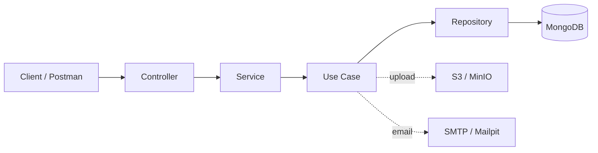
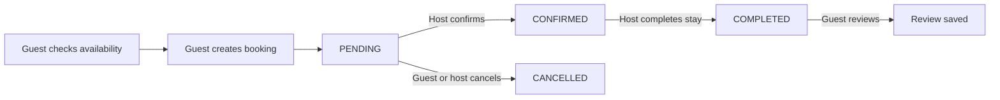

<div align="center">

# 🏡 Airbnb Clone API

**A modular, production-minded REST API for short-term rentals, bookings, and guest reviews.**

Built with **NestJS 11**, **TypeScript**, **MongoDB**, and **S3-compatible storage**.

<a href="https://skillicons.dev">
  
</a>

[Features](#-features) ·
[Quick Start](#-quick-start) ·
[API Reference](#-api-reference) ·
[Architecture](#-architecture) ·
[Postman](#-postman-testing) ·
[Security](#-security)

</div>

---

## 📑 Table of Contents

- [Overview](#-overview)
- [Features](#-features)
- [Tech Stack](#-tech-stack)
- [Architecture](#-architecture)
- [Quick Start](#-quick-start)
- [Configuration](#-configuration)
- [Authentication & Roles](#-authentication--roles)
- [API Documentation](#-api-documentation)
- [API Reference](#-api-reference)
- [Booking Lifecycle](#-booking-lifecycle)
- [Request & Response Conventions](#-request--response-conventions)
- [Request Examples](#-request-examples)
- [Postman Testing](#-postman-testing)
- [Security](#-security)
- [Development](#-development)
- [Project Structure](#-project-structure)
- [Design Notes](#-design-notes)
- [License](#-license)

---

## 📖 Overview

**Airbnb Clone API** is the backend of a rental-booking platform. It serves three kinds of consumers (guests, hosts, and system administrators) through a clean REST interface backed by MongoDB.

It covers the full rental workflow:

1. **Onboard** users with email OTP verification, JWT authentication, and password recovery.
2. **List** properties with rich filtering, pagination, and photo uploads to S3-compatible storage.
3. **Book** stays with real-time availability checks and automatic price + VAT calculation.
4. **Review** completed stays so future guests can make informed choices.

The codebase is organized into **self-contained feature modules**. Each module keeps its controllers, DTOs, services, use cases, repositories, schemas, and Swagger documentation together, which makes the project easy to navigate, test, and extend.

---

## ✨ Features

| Area | What you get |
| --- | --- |
| 🔐 **Authentication** | User and system-admin login, JWT access tokens, refresh-token rotation, and a protected `/auth/me` endpoint. |
| ✉️ **Email verification** | Six-digit OTP delivery and verification **before** registration is allowed. |
| 🔑 **Password recovery** | Send code → verify code → set a new password. |
| 👥 **Role-based access** | Separate `user` and `admin` flows enforced by authentication and role guards, plus ownership checks on units and bookings. |
| 🏠 **Rental units** | Create, list, filter, update, activate, deactivate, and soft-delete listings. |
| 🖼️ **Photo management** | Upload, add, and remove unit photos using S3-compatible object storage (MinIO locally). |
| 📅 **Bookings** | Availability check, cost + VAT calculation, reservation creation, and a host-driven status workflow. |
| ⭐ **Reviews** | Guests review completed bookings; anyone can browse a unit's reviews (newest first). |
| 🌍 **Reference data** | Admin-managed countries, cities, currencies, and unit categories. |
| ⚙️ **App settings** | Configurable VAT rate and minimum rental price. |
| 📧 **Mail testing** | Test endpoint plus a local Mailpit inbox for inspecting every outgoing email. |
| 🛡️ **Hardened by default** | Helmet, strict CORS allowlist, per-route rate limiting, DTO whitelisting, and file-signature validation. |
| 📚 **Interactive docs** | Swagger UI with bearer-auth support. |
| 🧪 **Postman collection** | 57 ready-to-run requests with auto-saved tokens and resource IDs. |

---

## 🧰 Tech Stack

| Technology | Purpose |
| --- | --- |
| [NestJS 11](https://nestjs.com/) | Modular server-side framework |
| [TypeScript](https://www.typescriptlang.org/) | Type-safe application language |
| [MongoDB](https://www.mongodb.com/) + [Mongoose 9](https://mongoosejs.com/) | Document database, schemas, and queries |
| `class-validator` / `class-transformer` | Request validation and transformation |
| `@nestjs/jwt` + guards | Authentication and authorization |
| `@nestjs/throttler` | Rate limiting |
| Helmet | Secure HTTP headers |
| Joi | Startup validation of environment variables |
| `bcryptjs` | Password hashing |
| `@nestjs/swagger` | OpenAPI generation and Swagger UI |
| AWS SDK v3 (`client-s3`, `lib-storage`, `s3-request-presigner`) | S3-compatible file storage |
| `magic-bytes.js` / `mime-types` | Upload validation by real file signature |
| [MinIO](https://min.io/) | Local S3-compatible storage for development |
| Nodemailer | Email transport |
| [Mailpit](https://mailpit.axllent.org/) | Local SMTP inbox for development and testing |
| Jest + Supertest | Unit and end-to-end testing |
| ESLint + Prettier | Linting and formatting |

---

## 🏗️ Architecture

Requests flow through a clear, layered pipeline. Controllers stay thin, **use cases** hold the business rules, and **repositories** are the only layer that talks to MongoDB.



| Layer | Responsibility |
| --- | --- |
| **Controller** | Declares HTTP routes, guards, and Swagger metadata. |
| **Service** | Coordinates application behavior for a feature. |
| **Use case** | Encapsulates a single business operation and its rules. |
| **Repository** | Centralizes all MongoDB access for a feature. |

---

## 🚀 Quick Start

### Prerequisites

- **Node.js 20+** and npm
- **MongoDB**, running locally or reachable remotely
- **Docker Desktop** (optional, but recommended for running MinIO and Mailpit locally)

> 💡 MongoDB is **not** included in `docker-compose.yml`. Start it separately, or point `MONGODB_URI` to an existing deployment (for example, MongoDB Atlas).

### 1. Clone and install

```bash
git clone https://github.com/devatta7/Airbnb-Clone-API.git
cd Airbnb-Clone-API
npm ci
```

### 2. Configure environment variables

Create a `.env` file in the project root. This is a suitable local starting point:

```env
NODE_ENV=development
PORT=3000

# MongoDB
MONGODB_URI=mongodb://localhost:27017/airbnb_clone

# JWT
JWT_SECRET=replace_with_a_long_random_secret
ACCESS_TOKEN_EXPIRES_IN=15m
REFRESH_TOKEN_EXPIRES_IN=7d

# Initial system-admin account (created on first startup)
SYSTEM_ADMIN_NAME=System Admin
SYSTEM_ADMIN_EMAIL=admin@example.com
SYSTEM_ADMIN_PASSWORD=replace_with_a_local_password

# S3-compatible storage (local MinIO)
AWS_S3_REGION=us-east-1
AWS_S3_ACCESS_KEY_ID=minioadmin
AWS_S3_SECRET_ACCESS_KEY=minioadmin123
AWS_S3_BUCKET_NAME=airbnb-api-clone
MINIO_S3_ENDPOINT=http://localhost:9000

# SMTP (local Mailpit)
SMTP_HOST=localhost
SMTP_PORT=1025
SMTP_SECURE=false
SMTP_AUTH_EMAIL=
SMTP_AUTH_PASS=
```

Configuration is validated at startup, so the app fails fast with a clear message if something is missing. See the full [Configuration](#-configuration) reference below.

### 3. Start local infrastructure

```bash
npm run docker:up
```

This launches the MinIO and Mailpit containers defined in `docker-compose.yml`:

| Service | Address | Notes |
| --- | --- | --- |
| MinIO S3 API | `http://localhost:9000` | Endpoint used by the API |
| MinIO Console | `http://localhost:9001` | Manage buckets and objects |
| Mailpit inbox | `http://localhost:8025` | Read OTPs and inspect sent emails |
| Mailpit SMTP | `localhost:1025` | SMTP host and port for local email |

**Create the storage bucket.** Open the MinIO Console (`http://localhost:9001`), sign in with the development credentials from `docker-compose.yml`, and create a bucket whose name matches `AWS_S3_BUCKET_NAME` (for example, `airbnb-api-clone`).

> ⚠️ The MinIO credentials in `docker-compose.yml` are for **local development only**. Never reuse them in a shared or production environment.

### 4. Run the API

```bash
npm run start:dev
```

The server listens on `PORT` (default **3000**). On startup it creates the initial system-admin account from your environment variables if one with that email doesn't already exist.

### 5. Explore the API

Open **Swagger UI** at:

```
http://localhost:3000/api
```

Click **Authorize** and paste a bearer access token to try protected endpoints.

---

## ⚙️ Configuration

| Variable | Required | Description |
| --- | :---: | --- |
| `NODE_ENV` | – | `development` or `production`. Enables HSTS and strict CORS in production. |
| `PORT` | – | HTTP port. Defaults to `3000`. |
| `MONGODB_URI` | ✅ | MongoDB connection string. |
| `JWT_SECRET` | ✅ | Secret used to sign tokens. Use a long, random value. |
| `ACCESS_TOKEN_EXPIRES_IN` | ✅ | Access-token lifetime (for example, `15m`). |
| `REFRESH_TOKEN_EXPIRES_IN` | ✅ | Refresh-token lifetime (for example, `7d`). |
| `SYSTEM_ADMIN_NAME` | ✅ | Display name of the seeded admin. |
| `SYSTEM_ADMIN_EMAIL` | ✅ | Email of the seeded admin. |
| `SYSTEM_ADMIN_PASSWORD` | ✅ | Password of the seeded admin. |
| `AWS_S3_REGION` | ✅ | S3 region. |
| `AWS_S3_ACCESS_KEY_ID` | ✅ | S3 access key. |
| `AWS_S3_SECRET_ACCESS_KEY` | ✅ | S3 secret key. |
| `AWS_S3_BUCKET_NAME` | ✅ | Bucket used for unit photos. |
| `MINIO_S3_ENDPOINT` | – | Custom S3 endpoint, used to target MinIO locally. |
| `SMTP_HOST` | ✅ | SMTP server host. |
| `SMTP_PORT` | ✅ | SMTP server port. |
| `SMTP_SECURE` | ✅ | `true` for TLS, `false` otherwise. |
| `SMTP_AUTH_EMAIL` | – | SMTP username (empty for Mailpit). |
| `SMTP_AUTH_PASS` | – | SMTP password (empty for Mailpit). |
| `CORS_ORIGINS` | 🏭 | Comma-separated frontend origins (no paths). Defaults to `http://localhost:5173` in development and is **required in production**. |

> 🔒 `.env` is ignored by Git. Keep real credentials out of source control.

---

## 🔐 Authentication & Roles

Login accepts one of two roles:

| Role | Account type | Typical capabilities |
| --- | --- | --- |
| `user` | Registered guest or host | Manage owned units, create bookings, and review stays |
| `admin` | System administrator | Manage users, reference data, and app settings |

Send the returned access token with every protected request:

```http
Authorization: Bearer <accessToken>
```

### Registering a user (local walkthrough)

Registration requires a verified email.

1. `POST /otp/send` with the email address.
2. Open Mailpit at `http://localhost:8025` and copy the six-digit code.
3. `POST /otp/verify` with the same email and code.
4. `POST /auth/register` with the verified email and account details.
5. `POST /auth/login` with `"role": "user"` to receive access and refresh tokens.

Use `POST /auth/refresh-token` to exchange a refresh token for a new token pair.

---

## 📚 API Documentation

| Resource | Location |
| --- | --- |
| **Swagger UI** (interactive) | `http://localhost:3000/api` |
| **Postman collection** | [`postman_collection.json`](./postman_collection.json) |
| **Postman environment** | [`postman_environment.json`](./postman_environment.json) |
| **Postman walkthrough** | [`POSTMAN_TESTING.md`](./POSTMAN_TESTING.md) |

> ℹ️ All API routes are served from the **root path**. There is no `/api` route prefix; `/api` is only the Swagger UI path.

---

## 🧭 API Reference

**Access legend:** `Public` = no token · `Authenticated` = any valid token · `User` = role `user` · `Admin` = role `admin` · `Owner` = the user who owns the unit · `Guest` / `Host` = the booking's guest or the unit's owner.

### Authentication & identity

| Method | Endpoint | Access | Description |
| --- | --- | --- | --- |
| `POST` | `/auth/register` | Public (verified email) | Register a user and issue tokens |
| `POST` | `/auth/login` | Public | Log in as a user or system admin |
| `POST` | `/auth/refresh-token` | Public (refresh token) | Issue a new access/refresh token pair |
| `GET` | `/auth/me` | Authenticated | Return the current principal |
| `POST` | `/otp/send` | Public | Send an email verification code |
| `POST` | `/otp/verify` | Public | Verify an email verification code |
| `POST` | `/forget-password/send` | Public | Send a password-reset code |
| `POST` | `/forget-password/verify` | Public | Verify the password-reset code |
| `POST` | `/forget-password/reset` | Public | Set a new password after verification |

### Accounts & app settings

| Method | Endpoint | Access | Description |
| --- | --- | --- | --- |
| `POST` | `/users` | Admin | Create a user directly |
| `GET` | `/app-settings` | Public | Read VAT and minimum-price settings |
| `PATCH` | `/app-settings` | Admin | Create or update app settings |
| `POST` | `/mail/test` | Authenticated | Send a test email |

### Reference data

Countries, cities, currencies, and unit categories share the same CRUD shape. **List and get are public; create, update, and delete require `admin`.**

| Resource | Endpoint | List filters |
| --- | --- | --- |
| 🌍 Countries | `/countries` | `page`, `limit`, `ignoreLimit`, `name`, `countryCode` |
| 🏙️ Cities | `/cities` | `page`, `limit`, `ignoreLimit`, `name`, `country` |
| 💱 Currencies | `/currencies` | `page`, `limit`, `ignoreLimit`, `name`, `currencyCode` |
| 🏷️ Unit categories | `/unit-categories` | `page`, `limit`, `ignoreLimit`, `name` |

```http
GET    /<resource>
GET    /<resource>/:id
POST   /<resource>          # Admin
PATCH  /<resource>/:id      # Admin
DELETE /<resource>/:id      # Admin · soft delete · returns 204
```

### Rental units

| Method | Endpoint | Access | Description |
| --- | --- | --- | --- |
| `GET` | `/units` | Public | List active units with filters and pagination |
| `GET` | `/units/me` | User | List units owned by the current user |
| `GET` | `/units/:id` | Public | Get a unit by ID |
| `POST` | `/units` | User | Create a unit and upload photos |
| `PATCH` | `/units/:id` | Owner | Update unit details |
| `PATCH` | `/units/:id/activate` | Owner | Activate a unit |
| `PATCH` | `/units/:id/deactivate` | Owner | Deactivate a unit |
| `PATCH` | `/units/:id/photos` | Owner | Add uploaded photos to a unit |
| `DELETE` | `/units/:id/photos` | Owner | Delete selected photos by URL |
| `DELETE` | `/units/:id` | Owner | Soft-delete a unit (returns 204) |

**List filters:** `page`, `limit`, `ignoreLimit`, `title`, `country`, `city`, `unitCategory`, `minCostPerDay`, `maxCostPerDay`, `availability`, `isActive`.

**Uploads:** unit creation and photo updates use `multipart/form-data` with up to **5 files** per request, each **≤ 2 MB**. Files are validated by their actual signature (JPEG, PNG, or PDF), not just their extension.

### Bookings

| Method | Endpoint | Access | Description |
| --- | --- | --- | --- |
| `GET` | `/bookings/check-availability` | Public | Check availability and calculate cost |
| `POST` | `/bookings` | User | Create a booking as a guest |
| `GET` | `/bookings` | Admin | List all bookings |
| `GET` | `/bookings/me` | User | List your bookings as guest or host |
| `GET` | `/bookings/:bookingId` | Guest, Host, or Admin | Get booking details |
| `PATCH` | `/bookings/:id` | Guest | Update a pending booking |
| `PATCH` | `/bookings/:id/cancel` | Guest | Cancel a booking |
| `PATCH` | `/bookings/:id/status` | Host | Confirm, cancel, or complete a booking |
| `PATCH` | `/bookings/:id/review` | Guest | Add a review after completion |

**List filters:** `page`, `limit`, `ignoreLimit`, `status`, `unit`, `checkIn`, `checkOut`. The `/bookings/me` list also accepts `userType=guest` or `userType=host`.

**Business rules**

- The total is calculated from the unit's daily price, the stay duration, and the configured VAT settings.
- A guest **cannot** book their own unit.
- The host can confirm a pending booking, cancel an eligible booking, or mark a confirmed booking completed.
- A guest can leave a review only **after** the stay is completed.

### Unit reviews

| Method | Endpoint | Access | Description |
| --- | --- | --- | --- |
| `GET` | `/units/:unitId/reviews` | Public | List a unit's reviews, newest first |

Supports `page`, `limit`, and `ignoreLimit`.

---

## 🔄 Booking Lifecycle



---

## 📦 Request & Response Conventions

**Successful responses** that contain data are wrapped in a `data` property by a global interceptor:

```json
{
  "data": {
    "id": "507f1f77bcf86cd799439011",
    "name": "Example"
  }
}
```

**Paginated responses** return a `data` array and a `meta` object:

```json
{
  "data": [],
  "meta": {
    "totalCount": 0,
    "page": 1,
    "limit": 10,
    "pageCount": 0
  }
}
```

Endpoints that return `204 No Content` have no body.

**Validation:** a global `ValidationPipe` transforms incoming values and **rejects properties that are not declared in the DTO**.

### Error codes

| Status | Meaning |
| --- | --- |
| `400 Bad Request` | Invalid body, query, ID, OTP, dates, or booking transition |
| `401 Unauthorized` | Missing, invalid, or expired access token |
| `403 Forbidden` | Valid account without permission for this resource or action |
| `404 Not Found` | Resource or related entity does not exist |
| `409 Conflict` | Duplicate account data such as email or phone number |
| `422 Unprocessable Entity` | Invalid uploaded file type, signature, or size |
| `429 Too Many Requests` | Rate limit exceeded; wait before retrying |

---

## 🧾 Request Examples

### Log in

```http
POST /auth/login
Content-Type: application/json
```

```json
{
  "email": "guest@example.com",
  "password": "Password123",
  "role": "user"
}
```

### Check availability

```http
GET /bookings/check-availability?unit=507f1f77bcf86cd799439011&checkIn=2027-01-10T00:00:00.000Z&checkOut=2027-01-14T00:00:00.000Z
```

### Create a booking

```http
POST /bookings
Authorization: Bearer <guestAccessToken>
Content-Type: application/json
```

```json
{
  "unit": "507f1f77bcf86cd799439011",
  "checkIn": "2027-01-10T00:00:00.000Z",
  "checkOut": "2027-01-14T00:00:00.000Z",
  "adultsCount": 2,
  "kidsCount": 0,
  "notes": "Late check-in requested"
}
```

### Create a unit with photos

Send `multipart/form-data`, with the unit fields as text and one or more files under the `photos` field.

| Field | Type | Example |
| --- | --- | --- |
| `title` | Text | `Modern apartment in Cairo` |
| `description` | Text | `A comfortable apartment near downtown.` |
| `address` | Text | `12 Nile Street, Cairo` |
| `costPerDay` | Number | `1200` |
| `country` | MongoDB ID | `507f1f77bcf86cd799439011` |
| `city` | MongoDB ID | `507f1f77bcf86cd799439012` |
| `unitCategory` | MongoDB ID | `507f1f77bcf86cd799439013` |
| `roomsCount` | Number | `2` |
| `adultsCount` | Number | `4` |
| `kidsCount` | Number | `1` |
| `photos` | File (×1–5) | JPEG, PNG, or PDF, ≤ 2 MB each |

> 💡 Create the country, city, and unit category (as admin) **before** creating your first unit, and run **App Settings → Update** so pricing rules exist.

---

## 🧪 Postman Testing

The repository ships with everything needed to test the full flow without writing a single request by hand:

| File | Purpose |
| --- | --- |
| [`postman_collection.json`](./postman_collection.json) | 57 requests organized by feature, with sample data, bearer auth, JSON bodies, and file-upload forms |
| [`postman_environment.json`](./postman_environment.json) | Local API URL, admin login values, and Mailpit address |
| [`POSTMAN_TESTING.md`](./POSTMAN_TESTING.md) | Step-by-step workflow from registration to review |

### Recommended test sequence

1. Import both JSON files and select the local environment.
2. Set `baseUrl` and enter the local admin email and password.
3. Run **Setup → Check API & Prepare Test Run**. It verifies the API is reachable, generates unique test emails, and clears IDs and tokens from earlier runs.
4. In **OTP**, send the registration code, read it from Mailpit (`http://localhost:8025`), and verify it.
5. In **Auth**, register and log in as the **guest**. Log in as **admin** too.
6. In **Users**, create a separate **host** account and log in as that host.
7. As admin, create the country, city, currency, and unit category, then run **App Settings → Update App Settings**.
8. As host, create a unit and select a real file in the `photos` field.
9. As guest, check availability and create a booking (the collection generates future dates automatically).
10. As host, confirm and complete the booking. Then, as guest, add the review.

Successful create and login requests automatically save IDs and tokens for later requests.

> ⚠️ Cancellation is an **alternate** flow. Don't run it before confirm → complete → review on the same booking. Photo-upload requests require you to pick a real local file in Postman.

---

## 🛡️ Security

| Concern | Approach |
| --- | --- |
| **Security headers** | Helmet adds standard HTTP headers. HSTS is enabled only when `NODE_ENV=production`, so serve production traffic over HTTPS. CSP is disabled for the API process so Swagger UI at `/api` can load its inline assets. |
| **CORS** | Strict allowlist via `CORS_ORIGINS`. Defaults to `http://localhost:5173` in development and is **required at production startup**. Only the `Authorization` header is used. Cookie credentials are **not** enabled. |
| **Rate limiting** | Default: 100 requests / IP / minute. Login and registration: 5 / minute. OTP send and password-reset send: 3 / 10 minutes. OTP verify and password reset: 5 / 10 minutes. |
| **Input validation** | DTO validation with whitelisting; unknown properties are rejected. |
| **Uploads** | Limited to 5 files × 2 MB and validated by real file signature. |
| **Passwords** | Hashed with `bcryptjs`. |
| **Secrets** | Environment-based and schema-validated at startup. `.env` is git-ignored. |
| **XSS** | The API returns JSON and stores user text as data without stripping HTML-like characters. **Clients must render API strings as text** (framework escaping) and never inject them as raw HTML. If you add a rich-HTML field, sanitize it with a maintained sanitizer before rendering. |

> 📌 **Scaling note:** rate-limit counters use in-memory storage. If you run multiple API instances in production, configure shared throttler storage (for example, Redis) and correct proxy IP handling.

---

## 🛠️ Development

| Command | Description |
| --- | --- |
| `npm run start` | Start the application |
| `npm run start:dev` | Start in watch mode |
| `npm run start:debug` | Start with the NestJS debugger |
| `npm run build` | Compile into `dist/` |
| `npm run start:prod` | Run the compiled application |
| `npm run lint` | Run ESLint with auto-fix |
| `npm run format` | Format source and test files with Prettier |
| `npm run test` | Run Jest unit tests |
| `npm run test:watch` | Run Jest in watch mode |
| `npm run test:cov` | Run tests with coverage |
| `npm run test:e2e` | Run end-to-end tests |
| `npm run docker:up` | Start MinIO and Mailpit |
| `npm run docker:down` | Stop MinIO and Mailpit |
| `npm run docker:down:rm` | Stop services **and delete** their Docker volumes |

### Production build

```bash
npm run build
NODE_ENV=production npm run start:prod
```

Remember to set `CORS_ORIGINS`, a strong `JWT_SECRET`, real S3 and SMTP credentials, and to serve the API behind HTTPS.

---

## 🗂️ Project Structure

```text
src/
├── app.module.ts
├── main.ts
├── auth/              # Authentication, JWT, roles, token refresh
├── users/             # User accounts
├── system-admins/     # Initial system-admin account and lookup
├── bookings/          # Booking lifecycle, availability, calculations
├── units/             # Rental listings, filtering, photo management
├── unit-reviews/      # Listing reviews
├── countries/         # Country reference data
├── cities/            # City reference data
├── currencies/        # Currency reference data
├── unit-categories/   # Unit category reference data
├── app-settings/      # VAT and minimum-price configuration
├── otp/               # Email verification codes
├── forget-password/   # Password-reset flow
├── mail/              # Email service and adapters
├── files-upload/      # S3-compatible storage integration
└── common/            # Config, shared data access, validation,
                       # interceptors, errors, files, Swagger helpers
```

Most feature modules follow the same internal layout:

```text
feature/
├── dtos/              # Request and response shapes
├── schema/            # Mongoose schema definitions
├── repository/        # Database operations
├── use-cases/         # Business operations
├── swagger/           # Endpoint documentation decorators
├── *.controller.ts
├── *.service.ts
└── *.module.ts
```

---

## 🧩 Design Notes

- **Soft deletes:** countries, cities, currencies, categories, and units use soft deletion where implemented. Consider existing references before removing reference data.
- **Pagination:** shared parameters are `page`, `limit`, and `ignoreLimit` where supported.
- **Pricing:** booking totals combine the unit's rate, the requested dates, and the app-level VAT configuration.
- **Storage:** the app uses the AWS S3 SDK and can target MinIO through `MINIO_S3_ENDPOINT`, so switching to AWS S3 or another compatible provider is a configuration change.
- **Email:** Mailpit captures all local messages without delivering to real inboxes.
- **Internal modules:** `system-admins` and `files-upload` support other features and expose no standalone CRUD controllers.

---

## 📄 License

This project currently declares **`UNLICENSED`** in `package.json`, meaning all rights are reserved by the author. If you'd like others to use or contribute to the code, add a license (for example, MIT) and update this section.

---

<div align="center">

**Built by [@devatta7](https://github.com/devatta7)**

If you find this project useful, consider giving it a ⭐

</div>
